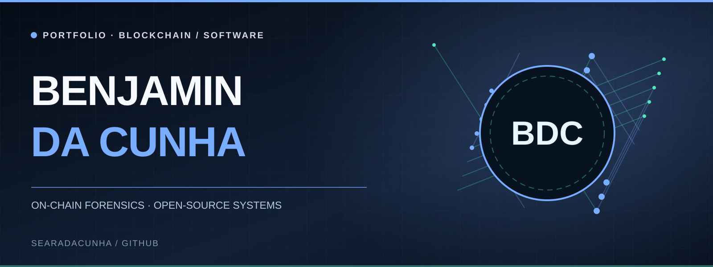

# Benjamin Da Cunha

### [WHY SOLANA MEMECOINS ARE OVER](https://github.com/searadacunha/Why-Solana-Memecoins-Are-Over) · On-chain manipulation and trading

**I started with approximately €400 and withdrawed $237,137.87 between October and December 2024.**

I identified recurring patterns of coordinated memecoin accumulation on Solana and used those publicly visible signals to trade while the opportunity lasted. When the pattern changed, I traced the wallets, funding routes and transactions to investigate the mechanics behind it.

### [POLYMARKET: HOME OF THE INSIDERS](https://github.com/searadacunha/Polymarket-Home-of-the-Insiders) · Cross-chain forensics

**A paradise for insiders? Follow the money, and the connections start to emerge.**

A broad investigation into prediction markets, from geopolitical events to the Ballon d'Or. By tracing deposits, bets and withdrawals across blockchains, I uncover verifiable financial relationships between accounts that initially appear independent.

### [DARK MAGA](https://github.com/searadacunha/Dark-MAGA) · On-chain investigation

**Did Elon know?** A Dark MAGA token launched before Elon Musk changed his X profile picture. I investigated early buyers, interconnected wallets, trading profits and cross-chain fund flows to test whether anyone was positioned with advance knowledge.
